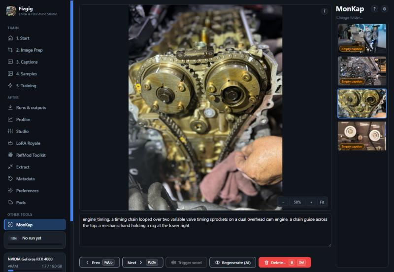
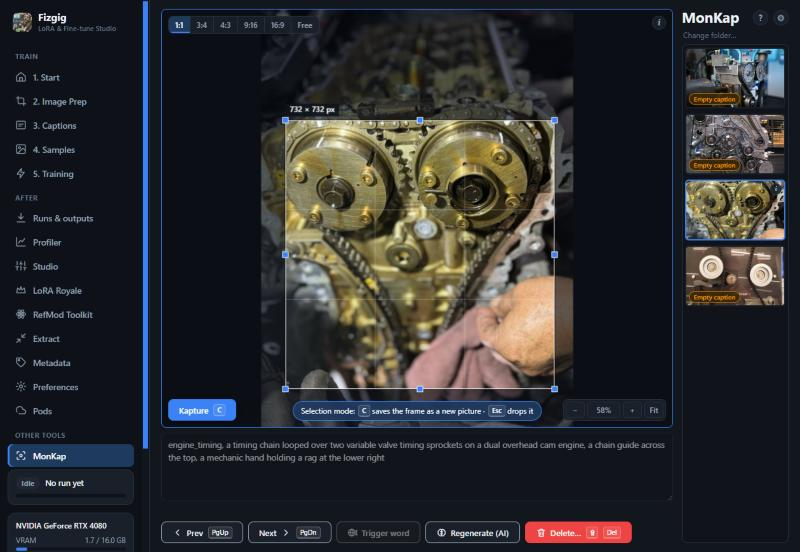
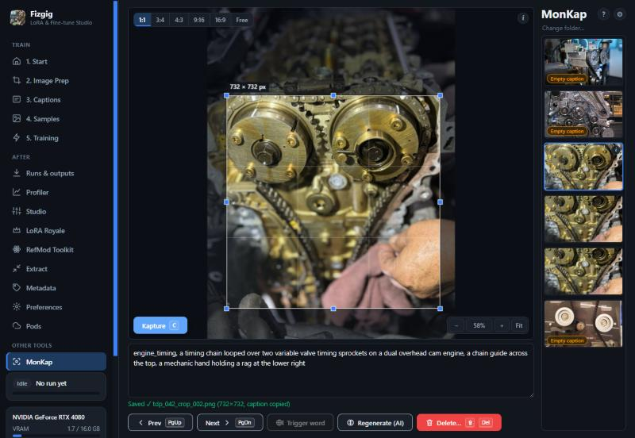

# MonKap

[← Back to the README](../README.md)

MonKap is a tool in the sidebar's **Other tools** group for going through a training folder one picture at a time: read and fix each caption, and **frame a part of a picture to save it as a new training picture** (Kapture) without leaving the page. Use it when the subject is small in the frame, or a picture holds several panels, and you would otherwise crop in another program and caption the crop by hand.

<p align="center"></p>

It works on the **training folder of the Start tab** and on the pictures the trainer reads (png, jpg, webp, bmp, avif). Clips and songs are left to the Captions tab.

## The page

- On the right: the filmstrip of the folder (thousands of pictures are fine: only the thumbnails on screen exist), under the tool's title. **?** next to the title explains the tool and lists the keys, the gear opens Settings, and **Change folder…** takes you to the Start tab, where the training folder is chosen. In a narrow window the filmstrip moves below and opens from a **Pictures** button.
- A thumbnail that has no caption says **Empty caption** (such a picture is left out of training). The small **i** on a thumbnail, and the one in the corner of the big picture, show a picture's name, size and place in the folder.
- Under the picture is its caption. The keyboard starts there: open a picture and type. It saves by itself a moment after you stop, when you move to another picture, when you leave the tab and when you close the page.
- **◀ Prev / Next ▶** (**PgUp / PgDn**, from the caption box too) move through the folder. The buttons show their keys.
- **Trigger word** puts the training folder's trigger word first in the caption (`trigger, caption`), unless the caption already has it as a phrase of its own (any case, not inside another word). It is greyed out then, and absent when the folder has no trigger word.
- In a narrow window the buttons lose their key hints first, and then their words: only the icons stay (previous, next, trigger word, Regenerate, delete).

## Kapture

<p align="center"></p>

Drag with the left mouse button to frame an area. The ratio buttons (1:1, 3:4, 4:3, 9:16, 16:9, Free) appear at the top left of the picture while there is a frame; the choice is remembered for the next one. The frame shows its size in the picture's own pixels, and keeps the ratio you chose. Drag its handles or inside it to adjust; arrow keys move it by a pixel (Shift: ten), with Ctrl they resize it. Press **C** (or the **Kapture** button that appears at the bottom left of the picture while there is a frame) and the framed area is saved next to the original as a new PNG.

- The crop is cut from the **original file at its own pixels**: nothing is resized or re-encoded beyond PNG, transparency and colour profile are kept. The original is never touched.
- The new file is written under a temporary name, read back to check its size, and only then given its name; it can never overwrite anything. It is called `<original>_crop_001.png`, `_002`, and so on. A number is **never used twice**, even after you delete a crop: the trainer's latent cache is keyed by picture name and size, so a new picture under a deleted picture's name would silently train on the old latents. The numbers come from the folder and from a log in `.monkap/names.log`.
- The frame and the view stay where they are, so a page with four panels is four presses of **C**.
- A held key makes one crop, not a stream of them.
- The new picture's caption starts as you chose in **Settings**: a copy of the original's, a copy with the trigger word first, or none. A crop with a copied caption carries a "copied from the original" note until you change its caption.

<p align="center"></p>

`C` and the other keys go by the physical key, so they work on any keyboard layout. While you type in the caption box, a letter is a letter; click the picture (or draw a frame) to switch to **selection mode**, shown by a ring round the picture and a banner, where C saves the frame and Esc drops it and returns to typing.

## View

The mouse wheel zooms at the cursor and the **middle button** drags the picture. On a touch screen one finger draws a frame and **two fingers** zoom and move the picture. The four small buttons at the bottom right (**−**, the zoom, **+**, **Fit**) do it too: the number is the real zoom, **100%** being one picture pixel per screen pixel (click it to get there), **Fit** shows the whole picture. Big pictures stay quick: the page shows a reduced copy of the whole picture and, when you zoom in, fetches the part on screen at full resolution. The right button is not used.

## Captions

- Clearing a caption on purpose removes its file (the old text is kept in `.monkap/backups/`), so the picture goes back to "needs a caption" and isn't trained on an empty one.
- If the caption file changed on disk while you edited (the AI captioner, another program), saving keeps the other text in `.monkap/backups/` and says so. Nothing is lost and nothing blocks you.
- **Regenerate (AI)** writes this picture's caption again with the model and task chosen on the Captions tab. The new text appears when it is done, with **Restore previous caption** beside it. Moving to another picture meanwhile is fine.
- Caption files follow the **Caption Extension** on the Captions tab.

## Deleting a picture

**Shift+Delete** (or the Delete button) asks first; **Enter** confirms, **Esc** cancels. In the caption box, Shift+Delete stays "Cut" while some text is selected. Which kind of delete it is, is your choice in **Settings**:

- **Move to the folder's `removed/` folder** (the default): the picture and its caption go to the same `removed/` folder as Captions > Remove, with an **Undo** beside the message.
- **Erase for good**: the picture, its caption and its cached latents are erased. The cache is cleaned by the exact file name only, so the crops of that picture keep theirs.

The confirmation can be switched off in Settings. A held key deletes one picture, not a row of them.

## Settings

**Settings…** on the tool's bar. They are kept in `user_data/monkap.json`.

- **Names of new pictures**: a template with `{parent}` (the original's name) and `{n}` / `{n:03d}` (the number, padded). A template without a number gets `_{n:03d}` added. A live example shows what it makes.
- **A new picture's caption**: copy / copy with trigger word / none. *None* means no caption file at all: a picture without one is left out of training, where an empty file would train on an empty caption.
- **Deleting a picture**: move to `removed/` or erase; and whether to ask first.
- **Remember where each crop came from**: a note per crop (`source`, the exact box) in `.monkap/provenance.jsonl`. It is never a caption.
- Rule-of-thirds lines in the frame.

## What it writes

Only inside the training folder: the new pictures and captions you ask for, and a hidden `.monkap/` folder (`names.log`, `provenance.jsonl`, `backups/`). The trainer's globs are not recursive, so it never reads `.monkap/`. Pictures MonKap sends to the page are never stored in the browser: every picture is sent with `Cache-Control: no-store`. Pictures are shown as they are stored, without turning them by their EXIF orientation (the trainer doesn't turn them either), so the frame is what the trainer will see.

## Limits

- Made for a mouse and a keyboard; touch works (one finger draws, two fingers zoom and move) but is less polished.
- A very big picture (tens of megapixels) takes a few seconds the first time it is opened, then zooms quickly; the server keeps the last few decoded.
- Each Kapture reads the original again, so a CMYK or 16-bit source is cut exactly; several crops of a huge picture each pay one decode.

## For developers

- `src/fizgig/monkap/`: what touches files, with no web server in it (`naming`, `ledger`, `crops`, `captions`, `jobs`, `cache`, `settings`).
- `src/fizgig/web/monkap_api.py`: the `/api/monkap/*` routes; `server.py` hands them over in two places.
- `src/fizgig/web/static/monkap.js`, `monkap_geo.js` (the frame and view maths, pure functions), `monkap.css`. From `app.js` the page uses only the shared helpers (`$`, `el`, `api`, `debounce`, `TOKEN`), the training folder (`S.imageFolder`) and, for Regenerate, the Captions tab's `capJobBody`.
- Tests, no GPU and no display needed:

```text
venv\Scripts\python.exe -I -m unittest discover -s src/fizgig/monkap/unit_tests
node --test "src/fizgig/monkap/js_tests/*.test.mjs"
```
